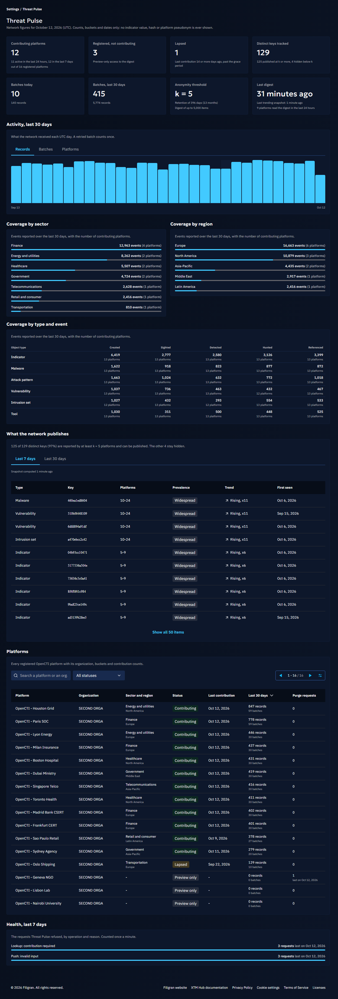

# Threat Pulse

Threat Pulse is the collective intelligence network of the OpenCTI community. Contributing OpenCTI platforms send keyed hashes and activity counts of the objects they observe, never values, and XTM Hub publishes back community prevalence, network first-seen dates, sector trends and sector benchmarks, only when enough distinct platforms observed the same object. Every connected platform, contributing or not, can download a coarse **preview** of the most prevalent objects without sending anything about its own data; contributing unlocks the full experience.

This page explains what XTM Hub receives, stores and publishes. The OpenCTI side (consent, scopes, exclusions, cards and widgets) is described in the OpenCTI documentation, in the Threat Pulse page of the XTM Hub integration.

## Requirements

- An OpenCTI product **connected to XTM Hub** (see [OpenCTI Product Connection](opencti-connection.md)).
- An OpenCTI version that ships Threat Pulse. The preview runs by default on every connected platform and sends nothing; contributing (and the full experience) requires an administrator to **enable the contribution** in **Settings > Filigran Experience** and accept the consent text, which OpenCTI records with the administrator and the date.

## What a platform sends

Every hour, a contributing OpenCTI platform sends one batch per UTC day with:

| Field | Content |
| --- | --- |
| `hash` | 32 hexadecimal characters derived from the object, encrypted under the salt of the day (see below). Never a value, a name or an identifier. |
| `object_type` | `indicator`, `attack_pattern`, `vulnerability`, `intrusion_set`, `malware` or `tool`. |
| `event_kind` | `created`, `sighted`, `detected`, `hunted` or `referenced`. |
| `count` | How many such events of the batch's UTC day this batch carries: the events recorded since the previous batch, never a running total of the day. XTM Hub adds the count of every new batch, so the events of a day sent across several batches are counted once each. |
| `sector_bucket`, `region_bucket` | Coarse buckets chosen by the administrator (for example `finance`, `europe`), or `undisclosed`. |
| `batch_id` | A random UUID drawn for the batch and sent again when the platform retries it. XTM Hub answers a batch it already recorded with its first result (its day and its number of records) and counts it once, so a retry after a lost response never inflates the counts. It is kept as long as the salt of its day, then deleted. A purge keeps it with a count of 0, so a batch accepted before the purge and sent again after it records nothing. |

The batch schema accepts no other field: XTM Hub rejects any batch that carries anything else.

Objects marked `TLP:RED`, `TLP:AMBER+STRICT` or `PAP:RED`, objects with restricted access and the markings the administrator excludes never leave the platform. No batch carries the name or an identifier of the organization, and the Threat Pulse tables of XTM Hub hold none: contributions are recorded under an internal platform number. XTM Hub still knows which organization registered the connected platform, because it validates the platform token against that organization's subscription; what Threat Pulse guarantees is that nothing about the organization travels with the contributions or is stored with them. The only place where a registration meets its contribution counts is the monitoring page of the Hub administrators (see [Monitoring the network](#monitoring-the-network)).

## How XTM Hub protects the contributions

1. **Daily salt.** XTM Hub draws a new random salt every UTC day (`pulseSalt`) and serves it to connected platforms only. The platform encrypts a stable keyed hash of each object under that salt, so the hashes it sends change every day: hashes recorded on different days (a proxy log, a copy of request bodies) cannot be linked to each other or to an object without the salts of those days. A salt is kept for its own UTC day and the two following days, then deleted. The salt is not a secret among connected platforms, and the stable keyed hash uses a key every OpenCTI platform shares (that is what lets the network match an object): a connected platform that knows a value can compute its hash for a day, as the preview does. Request bodies are therefore protected in transit by TLS, and what XTM Hub publishes is protected by k-anonymity (below), not by the salt.
2. **Re-keying at rest.** On reception, XTM Hub decrypts each hash with the salt of its day and immediately re-keys it with a secret key held only by XTM Hub (`PULSE_AT_REST_KEY`). The stored key cannot be computed by a platform, so the database alone does not reveal which objects a platform holds.
3. **Pseudonymized platforms.** Platform identifiers are stored as keyed pseudonyms (`PULSE_PLATFORM_KEY`), never in clear.
4. **k-anonymity.** Every published statistic (prevalence, first-seen, trends, trending lists, benchmarks, the preview digest) requires at least `k` distinct contributing platforms, 5 by default. Below the threshold, XTM Hub answers that the object is unpublished and returns no count. A week or a period below `k` weighs 0 in everything derived from it (the weekly series, the trend directions, the trending growth), so no published figure reveals it, and the first and last seen days only come from weeks that `k` distinct platforms reached: an object that `k` platforms reported over the retention period, in weeks that each stayed below `k`, is published without them. These days are week boundaries (the first day of the earliest such week and the last day of the latest one), never the day a single platform reported. With a threshold below 5, a count between `k` and 4 is published as the `<5` range and weighs `k` in the series, trends and trending growth.
5. **Coarse buckets.** Platform counts are returned as ranges (`5-9`, `10-24`, ... `250+`), never as exact numbers; the 12-week series carries, for each week, the lower bound of its range (5, 10, 25, 50, 100 or 250), and the trending growth and order are computed from those lower bounds, so two objects in the same range always publish the same growth.
6. **Retention.** Contributions older than the retention period (13 months by default) are deleted every night. Each deletion step is committed together with the invalidation of the cached digests and trending lists, so a run that stops halfway never leaves a cached answer that still holds what it deleted.
7. **Nothing in the logs.** The request logs never keep the text, the variables, the operation name, the error paths, the error messages or the stacks of Threat Pulse requests, nor the variables of any request sent without its query text (an automatic persisted query); an unexpected failure is logged with its error class and code only. A refused request is counted per UTC day, operation and error code, with nothing about the caller, for the [monitoring page](#monitoring-the-network).
8. **Right to purge.** An administrator can purge every contribution of the platform from OpenCTI at any time (`pulsePurge`). XTM Hub deletes them day by day, each day committed with the invalidation of the cached digests and trending lists, and recomputes the statistics. XTM Hub keeps how many purges each platform pseudonym requested per UTC day, nothing else, until the retention period deletes it.

## What a platform reads

### The preview (every connected platform)

`pulseSalt` and `pulseDigest` answer every connected platform, contributing or not. The digest is a download: the request carries the day and the coarse sector and region buckets of the platform, nothing about its objects. It holds:

- the `PULSE_DIGEST_SIZE` objects (5,000 by default) in the widest platforms ranges over the last 30 days, `k` platforms at least, each as a hash under the salt of the day with its community prevalence and its trend only. Objects are chosen and listed by platforms range (5-9, 10-24, ...), then in an order drawn from the day and the object: the order never tells which of two objects of one range more platforms reported, and the digests of two days list the objects of one range in unrelated orders;
- the trending list of the sector (and region) over the last 7 days: the first 3 ranks as hashes with their prevalence and trend, the next ones (up to rank 10) as a count only.

OpenCTI computes the hashes of its own objects locally, matches them against the digest and shows the result as the Threat Pulse preview. Nothing is sent back.

### The full experience (contributing platforms)

Reciprocity is enforced by XTM Hub: lookups, trending lists and benchmarks answer `PULSE_CONTRIBUTION_REQUIRED` to a platform that never contributed or whose last contribution is older than the grace period. Both periods are counted in UTC calendar days starting on the day of the last contribution: a platform is an **active contributor** during `PULSE_CONTRIBUTION_WINDOW_DAYS` (7) days and keeps the full experience during `PULSE_CONTRIBUTION_GRACE_DAYS` (14) days. With the defaults, a platform whose last contribution was exactly 7 days ago is in its grace period, and one whose last contribution was 14 days ago has lapsed: OpenCTI falls back to the preview until the next contribution. `pulseStatus` reports the contribution status (`active`, `grace`, `lapsed` or `none`) and the last day of read access.

| Operation | Purpose |
| --- | --- |
| `pulseStatus` | Day, anonymity threshold, retention, contributors range, contribution status and read access of the platform. |
| `pulseDigest` | The preview described above. Open to every connected platform. |
| `pulseLookup` | Community prevalence (`rare`, `uncommon`, `common`, `widespread`), contributing platforms range, network first and last seen days, 12-week trend and sector trend of up to 1,000 hashes. |
| `pulseTrending` | Objects rising in a sector and region over 7, 30 or 90 days, returned as hashes the platform matches against its own objects. |
| `pulseBenchmark` | The platform's activity per object type and event kind compared with the median of its sector, and the objects it reports above that median, ordered by their ratio to the median. Sector comparisons only count what the platform reported in its current sector (`sector_platform_count`); network comparisons count everything it reported over the period (`platform_count`). |

Every operation authenticates with the platform token of the connected product and is rate limited per platform.

## Monitoring the network

The XTM Hub administrators follow the network in **Settings > Threat Pulse**. The page is read only and open to the users who hold the bypass capability only. It shows counts, object types, buckets, platforms and UTC days: never a value, a hash sent by a platform or a platform pseudonym. Days are UTC calendar days, like everywhere in Threat Pulse.

### Network cards

| Card | What it shows |
| --- | --- |
| Contributing platforms | Platforms whose last contribution is within the grace period (`PULSE_CONTRIBUTION_GRACE_DAYS`), how many of them pushed a batch over the last 24 hours and how many contributed over the last 7 days, out of the active OpenCTI registrations. |
| Registered, not contributing | Active registrations with no contribution held (never contributed, purged or deleted by the retention): they read the preview only. The card also counts the former platforms, whose contributions are still within the retention period although no active registration matches them any more. |
| Lapsed | Platforms whose last contribution is older than the grace period. Their past contributions still count in the statistics until the retention deletes them, and they read the preview only until they contribute again. |
| Distinct keys tracked | Distinct objects held over the retention period, split into the keys reported by at least `k` platforms (the only ones that can be published) and the keys below `k`, which are never published. |
| Batches today, Batches, last 30 days | Batches accepted and records received (a record is one line of a batch: a hash with its type, event kind, count and buckets). A batch sent again with the same `batch_id` counts once. |
| Anonymity threshold | `k`, the retention period in days and months, and the size of the preview digest, as configured. |
| Last digest | When XTM Hub last computed a preview digest and a trending list, and how many platforms downloaded the digest over the last 24 hours. |

A dash means the figure cannot be computed while the service is disabled or its settings are invalid (see [Configuration](#configuration-self-hosted-xtm-hub)); a warning above the cards gives the reason, and the platforms table stays empty.

### Activity, last 30 days

Records, batches and contributing platforms per day over the last 30 days, every day present, today included. XTM Hub counts the batches and records of each platform per day when it accepts a batch. For the days pushed before this count existed, the records are rebuilt from the stored contributions and are a lower bound, and the batches only cover the receipts XTM Hub still held then (3 days).

### Coverage

The events reported over the last 30 days (the sum of the `count` fields) by sector bucket and by region bucket, then as a matrix of object types by event kind, each figure with the number of distinct contributing platforms. These are volumes per bucket, never per object.

### What the network publishes

The network-wide trending list over 7 or 30 days, all sectors and regions, read from the same cache the platforms read: object type, platforms range, prevalence, trend and growth, and network first-seen day. The page shows the first 10 items and up to 50 on demand. Each item is identified by the first 12 hexadecimal characters of its key at rest. That key is derived with `PULSE_AT_REST_KEY`, a secret only XTM Hub holds, so neither a platform nor an administrator can compute it from a value: it tells two items apart on the page and reveals nothing about the object. Above the list, the page gives the share of the distinct keys that reach `k`.

### Platforms

Every active OpenCTI registration with its title and organization, its sector and region buckets, its status (contributing, lapsed or preview only), its last contribution day, its batches and records over the last 30 days and the purges it requested over the retention period. The table can be searched by platform or organization name, filtered by status, sorted by any column but the buckets and paged.

To match a registration to its contributions, XTM Hub computes the pseudonym of each registered platform with `PULSE_PLATFORM_KEY`, in memory and for the request only: the pseudonyms never leave the service and no table stores the link between a registration and its contributions.

### Health, last 7 days

The requests Threat Pulse refused over the last 7 days, per operation and error code (for example `pulse_lookup` refused with `PULSE_CONTRIBUTION_REQUIRED` to a lapsed platform, or `push_pulse` refused with `BAD_USER_INPUT` for an invalid batch), with the last day each happened. XTM Hub counts them in memory and writes the counts once a minute; nothing about the caller or the request is kept.

### What k-anonymity hides

The threshold `k` protects what XTM Hub publishes to the platforms, and the page shows it as the platforms see it:

- an object reported by fewer than `k` distinct platforms is never published: no prevalence, no first-seen day, no trend, never in a trending list or in the digest. The page only counts how many such keys exist;
- in what is published, platform counts are ranges, never exact numbers, and a week or a period below `k` weighs 0 (see [How XTM Hub protects the contributions](#how-xtm-hub-protects-the-contributions)).

The monitoring figures themselves are not subject to `k`: an administrator sees the counts of each registered platform and of each bucket, even a bucket only one platform uses, which is why the page is limited to the XTM Hub administrators. No figure on the page tells which objects a platform reported.

### What XTM Hub stores for this page

| Table | Content | Kept |
| --- | --- | --- |
| `PulsePlatformDailyIngestion` | Per platform (its internal number) and per day: the batches accepted, the records received and the time of the last batch. | Until the retention period, deleted with the platform by a purge. |
| `PulsePurgeRequest` | Per platform pseudonym and per day: the number of purges requested. | Until the retention period, a purge included. |
| `PulseRejection` | Per day, operation and error code: the number of refused requests. | 30 days. |

The other figures come from the tables Threat Pulse already holds (contributions, daily totals, keys, cached digests and trending lists, rate limit counters) and from the registrations of the connected platforms.

## Configuration (self-hosted XTM Hub)

| Environment variable | Default | Description |
| --- | --- | --- |
| `PULSE_ENABLED` | `true` | Turns the Threat Pulse service on or off. |
| `PULSE_AT_REST_KEY` | none | 64 hexadecimal characters. Key used to re-key the hashes at rest. Required. |
| `PULSE_PLATFORM_KEY` | none | 64 hexadecimal characters, different from `PULSE_AT_REST_KEY`. Key used to pseudonymize platforms. Required. |
| `PULSE_K_THRESHOLD` | `5` | Minimum number of distinct platforms before a statistic is published (2 to 1000; values below 5 are not recommended). |
| `PULSE_RETENTION_MONTHS` | `13` | Retention of the contributions, in months, from 9 to 120: the 90-day trends compare the last 270 days. Below 9, the service stays disabled and the nightly retention still deletes contributions older than the configured period. |
| `PULSE_CONTRIBUTION_WINDOW_DAYS` | `7` | Number of UTC calendar days, starting on the day of its last contribution, during which a platform is an active contributor. |
| `PULSE_CONTRIBUTION_GRACE_DAYS` | `14` | Number of UTC calendar days, starting on the day of its last contribution, during which a platform keeps lookups, trending lists and benchmarks (at least `PULSE_CONTRIBUTION_WINDOW_DAYS`, and at most 28 days per month of `PULSE_RETENTION_MONTHS`, so that the retention never deletes a platform still in its grace period). |
| `PULSE_DIGEST_SIZE` | `5000` | Objects in the preview digest (100 to 20,000). |
| `PULSE_TRENDING_CACHE_TTL_MINUTES` | `60` | Cache duration of the trending lists and of the preview digest. |
| `PULSE_RATE_LIMIT_PUSH_PULSE`, `PULSE_RATE_LIMIT_PULSE_LOOKUP`, `PULSE_RATE_LIMIT_PULSE_TRENDING`, `PULSE_RATE_LIMIT_PULSE_BENCHMARK`, `PULSE_RATE_LIMIT_PULSE_SALT`, `PULSE_RATE_LIMIT_PULSE_STATUS`, `PULSE_RATE_LIMIT_PULSE_DIGEST` | `120`, `600`, `60`, `30`, `120`, `120`, `24` | Calls allowed per platform and per hour. |
| `PULSE_RATE_LIMIT_PULSE_PURGE` | `5` | Purges allowed per platform and per day. |

!!! warning "Keep the keys stable"

    Changing `PULSE_AT_REST_KEY` or `PULSE_PLATFORM_KEY` unlinks every stored statistic and every platform pseudonym from the new contributions, and a purge no longer finds the contributions stored before. With `helm install` and `helm upgrade`, the Helm chart generates both keys once and keeps them by reading its Secret from the cluster. A render without access to the cluster (`helm template`, GitOps tools) cannot read it and would generate new keys at every render: set `xtmhub.api.pulse.atRestKey` and `xtmhub.api.pulse.platformKey` (64 hexadecimal characters each, checked when the chart renders), or `xtmhub.api.pulse.existingSecret`, the name of a Secret managed outside the chart that holds `PULSE_AT_REST_KEY` and `PULSE_PLATFORM_KEY`. A key set in the values wins over the one already in the chart's Secret. Setting only one of the two keys is refused when the render cannot find the other in the chart's Secret (a first install, or a render without access to the cluster), as the other would change at every render. The API reads both keys as optional: a missing external Secret or key disables Threat Pulse only, as below.

When a key or a setting is missing or invalid, the service stays disabled and logs the reason; the rest of XTM Hub is not affected, and the nightly retention still applies whenever `PULSE_RETENTION_MONTHS` is valid. Trending lists and digests computed under another anonymity threshold, digest size or publication rule are recomputed, never served; a purge or the nightly retention discards them at once.
